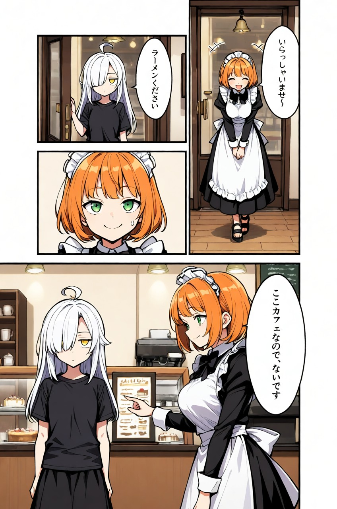

# pixai-manga

<p align="center"></p>

[English](#english) | [日本語](#japanese) | [中文](#chinese)

<a id="english"></a>
## English

A [Claude Code](https://claude.com/claude-code) skill that generates one-page manga images with the [PixAI](https://pixai.art) API and the **Tsubaki.3** image model.

- Generates color or black-and-white manga pages with vertical Japanese dialogue
- Builds an English prompt that Tsubaki.3 follows well from a JSON "page plan" (panel layout, camera, expressions, dialogue)
- Supports LoRAs and official PixAI recipes (neither is used by default)
- Saves the generated images locally

> **This is an unofficial tool** and is not affiliated with PixAI. Please follow PixAI's terms of service and API terms.

### Requirements

- [Claude Code](https://claude.com/claude-code)
- Python 3.9+ (standard library only)
- A PixAI account and API key (generation uses your PixAI credits)

### Installation

Copy the `pixai-manga` folder into your Claude Code skills folder:

- Windows: `%USERPROFILE%\.claude\skills\pixai-manga`
- macOS / Linux: `~/.claude/skills/pixai-manga`

### Setting up your API key

1. Log in to PixAI and create a key on the [API settings page](https://pixai.art/profile/edit/api)
2. Set it as the environment variable `PIXAI_API_KEY`

Windows (PowerShell):

```powershell
[Environment]::SetEnvironmentVariable("PIXAI_API_KEY", "<your key>", "User")
```

macOS / Linux (add to `~/.zshrc` or `~/.bashrc`):

```bash
export PIXAI_API_KEY="<your key>"
```

Restart your terminal and Claude Code afterwards. Never share your key or paste it into a chat.

### Usage

Just ask Claude Code:

> Make a 4-panel manga with PixAI where a maid fails at latte art in a cafe

You can also run the script directly:

```bash
python scripts/pixai_manga.py examples/cafe_4koma.json --dry-run   # show the prompt only (no credits used)
python scripts/pixai_manga.py examples/cafe_4koma.json --out output
python scripts/pixai_manga.py examples/cafe_4koma.json --batch 4   # make 4 and pick the best
```

Main options:

| Option | Description |
|---|---|
| `--batch 4` | Generate 4 images with the same settings |
| `--aspect 3:5` | Aspect ratio (1:1, 2:3, 3:2, 3:4, 4:3, 3:5, 5:3, 9:16, 16:9, 1:3, 3:1) |
| `--xl` | Generate at 1104×1824 |
| `--mode pro` | Quality (lite / standard / pro / ultra; default pro) |
| `--lora <versionId>:<weight>` | LoRA (must support Tsubaki.3 / DiT.3; up to 5) |
| `--trigger "..."` | LoRA trigger words |
| `--style retro-tv-anime` | Official recipe |
| `--seed 12345` | Seed |

See [SKILL.md](SKILL.md) and [references/prompt-guide.md](references/prompt-guide.md) for how to write a page plan (these are written in Japanese).

### Contents

```
pixai-manga/
├── SKILL.md                    Skill description (read by Claude Code)
├── scripts/pixai_manga.py      Generation script
├── references/prompt-guide.md  How to write Tsubaki.3 manga prompts
└── examples/cafe_4koma.json    Example page plan
```

### Notes

- The model is Tsubaki.3 ([model page](https://pixai.art/ja/model/2024383378759147749/2024383379556065549), version ID `2024383379556065549`)
- Some settings (such as 1104×1824 via `width` / `height`) rely on behavior that is not yet in the [official API docs](https://platform.pixai.art/ja/docs). They may stop working if PixAI changes the API
- Recipes from PixAI's Recipe Market cannot be used through the API (only the 35 official recipes can)
- The AI decides the final art and lettering, so results may not match your instructions exactly
- When using real people or characters from existing works, check the rights holder's guidelines

### License

[MIT License](LICENSE)

<a id="japanese"></a>
## 日本語

[PixAI](https://pixai.art) の API と画像生成モデル **Tsubaki.3** で、1ページの漫画画像を生成する Claude Code 用のスキルです。

- カラー／モノクロの漫画を、日本語の縦書きセリフ入りで生成
- コマ割り・カメラ・表情・セリフを書いた JSON（ページ設計図）から、Tsubaki.3 がよく守る英語のプロンプトを自動で組み立てる
- LoRA と公式レシピを指定できる（既定はどちらも使わない）
- 生成した画像はローカルに保存

> **非公式のツールです。** PixAI とは関係ありません。PixAI の利用規約と API の規約に従って使ってください。

### 必要なもの

- [Claude Code](https://claude.com/claude-code)
- Python 3.9 以上（標準ライブラリだけで動きます）
- PixAI のアカウントと API キー（生成には PixAI のクレジットを使います）

### インストール

`pixai-manga` フォルダを、Claude Code のスキルのフォルダにコピーします。

- Windows：`%USERPROFILE%\.claude\skills\pixai-manga`
- macOS / Linux：`~/.claude/skills/pixai-manga`

### API キーの設定

1. PixAI にログインし、[API の設定ページ](https://pixai.art/profile/edit/api)でキーを作ります
2. 環境変数 `PIXAI_API_KEY` に設定します

Windows（PowerShell）：

```powershell
[Environment]::SetEnvironmentVariable("PIXAI_API_KEY", "<あなたのキー>", "User")
```

macOS / Linux（`~/.zshrc` や `~/.bashrc` に追記）：

```bash
export PIXAI_API_KEY="<あなたのキー>"
```

設定したら、ターミナルと Claude Code を開き直してください。キーは他人に見せたり、チャットに貼ったりしないでください。

### 使い方

Claude Code に話しかけるだけで使えます。

> PixAIで、カフェでメイドがラテアートを失敗する4コマ漫画を作って

スクリプトを直接使うこともできます。

```bash
python scripts/pixai_manga.py examples/cafe_4koma.json --dry-run   # 送るプロンプトを確認（クレジットを使わない）
python scripts/pixai_manga.py examples/cafe_4koma.json --out output
python scripts/pixai_manga.py examples/cafe_4koma.json --batch 4   # 4枚作って選ぶ
```

主なオプション：

| オプション | 説明 |
|---|---|
| `--batch 4` | 同じ設定で4枚 |
| `--aspect 3:5` | 縦横比（1:1, 2:3, 3:2, 3:4, 4:3, 3:5, 5:3, 9:16, 16:9, 1:3, 3:1） |
| `--xl` | 1104×1824 で生成 |
| `--mode pro` | 品質（lite / standard / pro / ultra。既定 pro） |
| `--lora <バージョンID>:<重み>` | LoRA（Tsubaki.3 / DiT.3 対応のもの。最大5つ） |
| `--trigger "..."` | LoRA のトリガーワード |
| `--style retro-tv-anime` | 公式レシピ |
| `--seed 12345` | シード |

ページ設計図の書き方は [SKILL.md](SKILL.md) と [references/prompt-guide.md](references/prompt-guide.md) を見てください。

### 中身

```
pixai-manga/
├── SKILL.md                    スキルの説明（Claude Code が読む）
├── scripts/pixai_manga.py      生成スクリプト
├── references/prompt-guide.md  Tsubaki.3 の漫画プロンプトの書き方
└── examples/cafe_4koma.json    ページ設計図の例
```

### 注意

- 使うモデルは Tsubaki.3（[モデルページ](https://pixai.art/ja/model/2024383378759147749/2024383379556065549)、バージョンID `2024383379556065549`）です
- 一部の設定（`width` / `height` による 1104×1824 の指定など）は、[公式の API ドキュメント](https://platform.pixai.art/ja/docs)にまだ載っていない動きを使っています。PixAI 側の変更で動かなくなることがあります
- サイトの「レシピマーケット」のレシピは、API では使えません（公式レシピ35種類だけ使えます）
- 生成される絵やセリフは AI が決めるため、指定どおりにならないことがあります
- 実在の人物や既存作品のキャラクターを使うときは、権利者のガイドラインを確認してください

### ライセンス

[MIT License](LICENSE)

<a id="chinese"></a>
## 中文

一个 [Claude Code](https://claude.com/claude-code) 技能（Skill），使用 [PixAI](https://pixai.art) 的 API 和图像生成模型 **Tsubaki.3** 生成单页漫画。

- 生成彩色或黑白漫画，对白为日文竖排
- 根据 JSON「页面设计图」（分镜、镜头、表情、对白），自动生成 Tsubaki.3 能很好遵循的英文提示词
- 可指定 LoRA 和 PixAI 官方配方（Recipe），默认都不使用
- 生成的图片保存在本地

> **这是非官方工具**，与 PixAI 无关。请遵守 PixAI 的服务条款和 API 条款。

### 需要准备

- [Claude Code](https://claude.com/claude-code)
- Python 3.9 以上（只使用标准库）
- PixAI 账号和 API 密钥（生成会消耗你的 PixAI 积分）

### 安装

将 `pixai-manga` 文件夹复制到 Claude Code 的技能文件夹：

- Windows：`%USERPROFILE%\.claude\skills\pixai-manga`
- macOS / Linux：`~/.claude/skills/pixai-manga`

### 设置 API 密钥

1. 登录 PixAI，在 [API 设置页面](https://pixai.art/profile/edit/api)创建密钥
2. 将其设置为环境变量 `PIXAI_API_KEY`

Windows（PowerShell）：

```powershell
[Environment]::SetEnvironmentVariable("PIXAI_API_KEY", "<你的密钥>", "User")
```

macOS / Linux（添加到 `~/.zshrc` 或 `~/.bashrc`）：

```bash
export PIXAI_API_KEY="<你的密钥>"
```

设置后请重新打开终端和 Claude Code。请不要把密钥给别人看，也不要粘贴到聊天中。

### 使用方法

直接对 Claude Code 说即可：

> 用 PixAI 做一个女仆在咖啡店拉花失败的四格漫画

也可以直接运行脚本：

```bash
python scripts/pixai_manga.py examples/cafe_4koma.json --dry-run   # 只显示提示词（不消耗积分）
python scripts/pixai_manga.py examples/cafe_4koma.json --out output
python scripts/pixai_manga.py examples/cafe_4koma.json --batch 4   # 生成 4 张并挑选最好的
```

主要选项：

| 选项 | 说明 |
|---|---|
| `--batch 4` | 用相同设置生成 4 张 |
| `--aspect 3:5` | 宽高比（1:1, 2:3, 3:2, 3:4, 4:3, 3:5, 5:3, 9:16, 16:9, 1:3, 3:1） |
| `--xl` | 以 1104×1824 生成 |
| `--mode pro` | 质量（lite / standard / pro / ultra，默认 pro） |
| `--lora <版本ID>:<权重>` | LoRA（需支持 Tsubaki.3 / DiT.3，最多 5 个） |
| `--trigger "..."` | LoRA 触发词 |
| `--style retro-tv-anime` | 官方配方 |
| `--seed 12345` | 种子 |

页面设计图的写法请参阅 [SKILL.md](SKILL.md) 和 [references/prompt-guide.md](references/prompt-guide.md)（日文）。

### 内容

```
pixai-manga/
├── SKILL.md                    技能说明（由 Claude Code 读取）
├── scripts/pixai_manga.py      生成脚本
├── references/prompt-guide.md  Tsubaki.3 漫画提示词写法
└── examples/cafe_4koma.json    页面设计图示例
```

### 注意事项

- 使用的模型是 Tsubaki.3（[模型页面](https://pixai.art/ja/model/2024383378759147749/2024383379556065549)，版本 ID `2024383379556065549`）
- 部分设置（如通过 `width` / `height` 指定 1104×1824）使用了[官方 API 文档](https://platform.pixai.art/ja/docs)中尚未记载的功能，PixAI 更新后可能失效
- PixAI「配方市场」中的配方无法通过 API 使用（只能使用 35 种官方配方）
- 最终的画面和文字由 AI 决定，结果可能与指定内容不完全一致
- 使用真实人物或现有作品的角色时，请确认版权方的指南

### 许可证

[MIT License](LICENSE)
